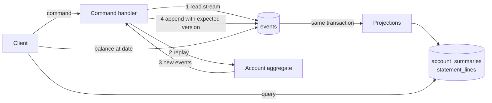

# Bank Account · Event Sourcing

[](https://github.com/edybackend/bank-account-event-sourcing/actions/workflows/ci.yml)
[Leia em português](README.pt-BR.md)

A bank account built with **DDD, CQRS and Event Sourcing** on .NET 10. The balance is never stored as the source of
truth: every deposit, withdrawal and transfer is an event, the account is rebuilt by replaying them, and the screens
read from projections updated in the same transaction. Because the history is the data, the API can also answer
*"what was the balance on October 15?"*.

## Quick start

Requirements: Docker.

```bash
docker compose up --build
```

Open http://localhost:8080/scalar for the interactive API reference. Four sample accounts come with six weeks of history
(salaries, rent transfers, a closed account). There is also a [`requests.http`](requests.http) file for Visual Studio, Rider or VS Code.

| What | Where |
|---|---|
| API reference (Scalar) | http://localhost:8080/scalar |
| OpenAPI document | http://localhost:8080/openapi/v1.json |
| Health check | http://localhost:8080/health |

<details>
<summary>Without Docker (.NET 10 SDK)</summary>

```bash
dotnet run --project src/BankAccount.Api   # http://localhost:8080/scalar
```
</details>

## How it works



1. The handler reads the account's stream and replays it into the `Account` aggregate.
2. The command checks the business rules against that state and raises new events.
3. The events are appended **only if the stream is still at the version that was read**. In the same SQLite
   transaction, the projections update the account summary and the statement.
4. If another request appended first, the whole command runs again on the fresh stream, so the rules are
   re-checked against the real balance (up to 3 attempts, then `409`).

A transfer appends `TransferSent` and `TransferReceived` to two streams in one transaction: the money leaves one
account only if it arrives in the other.

### An event stream

```
GET /api/accounts/{id}/events
v1  AccountOpened     owner "Ana Souza", BRL, daily limit 5,000.00
v2  MoneyDeposited    8,500.00  "Salary"
v3  MoneyWithdrawn      400.00  "ATM"
v4  TransferSent      1,250.00  "Rent share" → Bruno
...
```

## Business rules

- Amounts are positive with at most two decimal places; currencies `BRL`, `USD`, `EUR`, never mixed.
- No overdraft. Withdrawals plus outgoing transfers are limited to 5,000.00 per UTC day.
- Transfers only between different accounts with the same currency.
- A closed account accepts no money; only an account with zero balance can be closed.

## API

| Method | Route | What it does |
|---|---|---|
| `POST` | `/api/accounts` | open an account → `AccountOpened` |
| `POST` | `/api/accounts/{id}/deposits` | `MoneyDeposited` |
| `POST` | `/api/accounts/{id}/withdrawals` | `MoneyWithdrawn` |
| `POST` | `/api/transfers` | `TransferSent` + `TransferReceived` |
| `POST` | `/api/accounts/{id}/close` | `AccountClosed` |
| `GET` | `/api/accounts`, `/api/accounts/{id}` | summaries (read model) |
| `GET` | `/api/accounts/{id}/statement` | statement lines with balance after each one (read model) |
| `GET` | `/api/accounts/{id}/balance?at=` | balance at any moment (replay up to `at`) |
| `GET` | `/api/accounts/{id}/events` | the raw event stream |

Errors are RFC 9457 problem details: `400` invalid input, `404` unknown account, `409` conflict after retries, `422` business rule.

## Tech stack

| Area | Choice |
|---|---|
| Back-end | .NET 10, minimal APIs, OpenAPI + Scalar |
| Persistence | SQLite event store and read models with Dapper; one transaction per command |
| Quality | xUnit v3 (given/when/then aggregate tests), WebApplicationFactory, NetArchTest, Roslyn analyzers (warnings as errors) |
| Delivery | Multi-stage non-root image, Docker Compose, GitHub Actions |

## Project structure

```
src/
  BankAccount.Domain/          Account aggregate, Money value object, events
  BankAccount.Application/     command handler with retry, IEventStore and read-model ports, balance history
  BankAccount.Infrastructure/  SQLite event store, projections, read-model queries, sample data
  BankAccount.Api/             endpoints, problem details mapping, composition root
tests/                         unit (given/when/then), integration and architecture tests
specs/                         feature specs (spec-first workflow)
```

## Design decisions

- **Events are the data.** The account is a fold over its events; a test checks that every read model equals a full replay.
- **Events carry primitives.** The stored event is a contract; value objects can change without breaking old streams. Type names are mapped explicitly, never loaded by reflection from the database.
- **Optimistic concurrency per stream.** The version is checked inside a `BEGIN IMMEDIATE` transaction, and a unique `(stream_id, version)` index is the second guard.
- **Retry commands, not decisions.** Unlike a UI edit, a command can safely run again on the fresh stream because its rules are re-checked. Simultaneous deposits are retried instead of lost; simultaneous withdrawals can never overdraw.
- **Synchronous projections.** Updated in the append transaction, so reads are immediately consistent. Money in read models is stored in cents.
- **Dapper, not an ORM.** An event store is a handful of SQL statements.

## Tests

```bash
dotnet test   # aggregate given/when/then, integration (real API + SQLite, concurrent commands) and architecture tests
```

## Known trade-offs

- **One database for all streams.** It makes the two-stream transfer a single transaction. If accounts lived in different services, a transfer would be a saga with compensation.
- **No snapshots.** Each command replays the whole stream, which is fine for thousands of events per account; a long-lived account would add snapshots.
- **Synchronous projections.** Simple and consistent, but a slow projection slows the command. At scale they would run asynchronously from the event log, with eventual consistency.
- **SQLite.** Chosen so the project runs with no external database; production would use PostgreSQL or a dedicated event store.

## Working with an AI agent

Stored events are a contract that outlives the code, so this is where an assistant could do the most damage with a harmless-looking rename. A hook in [`.claude/`](.claude) blocks removing or renaming any field of a stored event; [`CLAUDE.md`](CLAUDE.md) explains the event sourcing rules and the only allowed way to evolve them (add, never change).

## License

[MIT](LICENSE)
