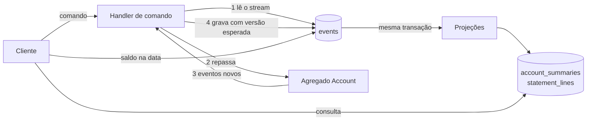

# Bank Account · Event Sourcing

[](https://github.com/edybackend/bank-account-event-sourcing/actions/workflows/ci.yml)
[Read in English](README.md)

Uma conta bancária construída com **DDD, CQRS e Event Sourcing** em .NET 10. O saldo nunca é guardado como fonte da
verdade: cada depósito, saque e transferência é um evento, a conta é reconstruída repassando esses eventos, e as telas
leem de projeções atualizadas na mesma transação. Como o histórico é o próprio dado, a API também responde
*"qual era o saldo em 15 de outubro?"*.

Pequeno de propósito: dá para ler em cerca de 15 minutos e subir com um comando.

## Como rodar

Requisito: Docker.

```bash
docker compose up --build
```

Abra http://localhost:8080/scalar para a referência interativa da API. Quatro contas de exemplo vêm com seis semanas
de histórico (salários, transferências de aluguel, uma conta encerrada). Há também um arquivo [`requests.http`](requests.http) para Visual Studio, Rider ou VS Code.

| O quê | Onde |
|---|---|
| Referência da API (Scalar) | http://localhost:8080/scalar |
| Documento OpenAPI | http://localhost:8080/openapi/v1.json |
| Health check | http://localhost:8080/health |

<details>
<summary>Sem Docker (.NET 10 SDK)</summary>

```bash
dotnet run --project src/BankAccount.Api   # http://localhost:8080/scalar
```
</details>

## Como funciona



1. O handler lê o stream da conta e o repassa no agregado `Account`.
2. O comando confere as regras de negócio nesse estado e gera eventos novos.
3. Os eventos só são gravados **se o stream ainda estiver na versão que foi lida**. Na mesma transação do SQLite,
   as projeções atualizam o resumo da conta e o extrato.
4. Se outra requisição gravou antes, o comando inteiro roda de novo sobre o stream atualizado, e as regras são
   conferidas de novo contra o saldo real (até 3 tentativas; depois, `409`).

Uma transferência grava `TransferSent` e `TransferReceived` em dois streams numa única transação: o dinheiro só sai
de uma conta se chegar na outra.

### Um stream de eventos

```
GET /api/accounts/{id}/events
v1  AccountOpened     dona "Ana Souza", BRL, limite diário 5.000,00
v2  MoneyDeposited    8.500,00  "Salary"
v3  MoneyWithdrawn      400,00  "ATM"
v4  TransferSent      1.250,00  "Rent share" → Bruno
...
```

## Regras de negócio

- Valores positivos com no máximo duas casas decimais; moedas `BRL`, `USD`, `EUR`, nunca misturadas.
- Sem cheque especial. Saques mais transferências enviadas têm limite de 5.000,00 por dia (UTC).
- Transferência só entre contas diferentes e da mesma moeda.
- Conta encerrada não recebe dinheiro; só se encerra conta com saldo zero.

## API

| Método | Rota | O que faz |
|---|---|---|
| `POST` | `/api/accounts` | abre conta → `AccountOpened` |
| `POST` | `/api/accounts/{id}/deposits` | `MoneyDeposited` |
| `POST` | `/api/accounts/{id}/withdrawals` | `MoneyWithdrawn` |
| `POST` | `/api/transfers` | `TransferSent` + `TransferReceived` |
| `POST` | `/api/accounts/{id}/close` | `AccountClosed` |
| `GET` | `/api/accounts`, `/api/accounts/{id}` | resumos (read model) |
| `GET` | `/api/accounts/{id}/statement` | extrato com o saldo após cada linha (read model) |
| `GET` | `/api/accounts/{id}/balance?at=` | saldo em qualquer momento (repassa até `at`) |
| `GET` | `/api/accounts/{id}/events` | o stream de eventos bruto |

Os erros seguem a RFC 9457 (problem details): `400` entrada inválida, `404` conta inexistente, `409` conflito após as tentativas, `422` regra de negócio.

## Tecnologias

| Área | Escolha |
|---|---|
| Back-end | .NET 10, minimal APIs, OpenAPI + Scalar |
| Persistência | Event store e read models em SQLite com Dapper; uma transação por comando |
| Qualidade | xUnit v3 (testes do agregado em dado/quando/então), WebApplicationFactory, NetArchTest, analisadores Roslyn (warnings como erro) |
| Entrega | Imagem multi-stage sem root, Docker Compose, GitHub Actions |

## Estrutura

```
src/
  BankAccount.Domain/          agregado Account, value object Money, eventos
  BankAccount.Application/     handler de comandos com nova tentativa, portas do event store e do read model, histórico de saldo
  BankAccount.Infrastructure/  event store em SQLite, projeções, consultas do read model, dados de exemplo
  BankAccount.Api/             endpoints, mapeamento para problem details, composition root
tests/                         testes de unidade (dado/quando/então), integração e arquitetura
specs/                         specs das funcionalidades (spec first)
```

## Decisões de design

- **Os eventos são o dado.** A conta é o resultado de repassar seus eventos; um teste confere que cada read model é igual a um replay completo.
- **Eventos carregam tipos primitivos.** O evento gravado é um contrato; value objects podem mudar sem quebrar streams antigos. Os nomes de tipo são mapeados explicitamente, nunca carregados por reflexão a partir do banco.
- **Concorrência otimista por stream.** A versão é conferida dentro de uma transação `BEGIN IMMEDIATE`, e um índice único `(stream_id, version)` é a segunda proteção.
- **Repetir comandos, não decisões.** Diferente de uma edição na tela, um comando pode rodar de novo sobre o stream atualizado porque as regras são conferidas de novo. Depósitos simultâneos são repetidos em vez de perdidos; saques simultâneos nunca deixam a conta negativa.
- **Projeções síncronas.** Atualizadas na transação da gravação, então a leitura é imediatamente consistente. Dinheiro nos read models fica em centavos.
- **Dapper, não um ORM.** Um event store é meia dúzia de comandos SQL.

## Testes

```bash
dotnet test   # agregado em dado/quando/então, integração (API real + SQLite, comandos simultâneos) e arquitetura
```

## Trade-offs conhecidos

- **Um banco para todos os streams.** Isso faz a transferência entre dois streams caber numa transação. Se as contas estivessem em serviços diferentes, a transferência seria uma saga com compensação.
- **Sem snapshots.** Cada comando repassa o stream inteiro, o que serve para milhares de eventos por conta; uma conta muito antiga ganharia snapshots.
- **Projeções síncronas.** Simples e consistentes, mas uma projeção lenta atrasa o comando. Em escala, rodariam de forma assíncrona a partir do log de eventos, com consistência eventual.
- **SQLite.** Escolhido para o projeto rodar sem banco externo; em produção seria PostgreSQL ou um event store dedicado.

## Engenharia assistida por IA

Este projeto foi construído com o Claude Code sob controles explícitos de engenharia:

- **Regras do projeto** ([`CLAUDE.md`](CLAUDE.md)) definem a arquitetura e as regras de event sourcing que o agente deve seguir.
- **Hooks** ([`.claude/settings.json`](.claude/settings.json)) formatam cada alteração, bloqueiam edição de segredos e do banco, **bloqueiam remover ou renomear campos de eventos já gravados** e rodam build e testes antes de uma tarefa ser considerada pronta.
- **Spec first**: cada funcionalidade começa como uma spec em [`specs/`](specs) com critérios de aceite.
- **Os mesmos portões para cada linha**: o CI exige warnings como erro, formatação, testes de unidade/integração/arquitetura, smoke test do contêiner e varredura de segredos.

A arquitetura é minha e eu reviso cada alteração.

## Licença

[MIT](LICENSE)
